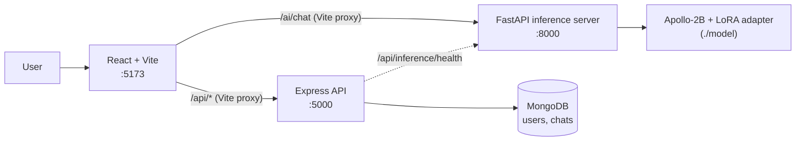
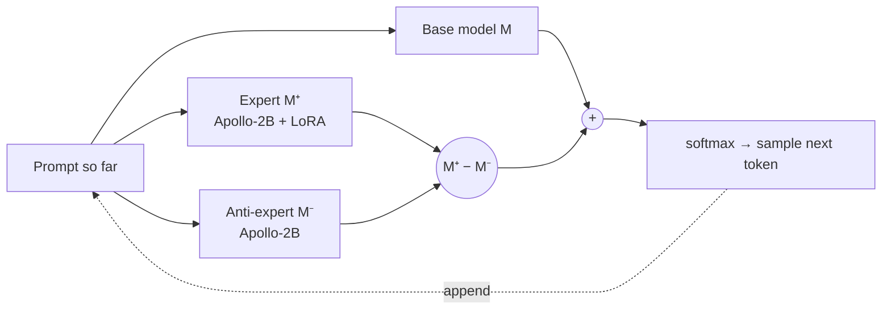

<div align="center">

# 🩺 Cura

**An AI healthcare assistant built on proxy tuning: a small LoRA-tuned medical expert (Apollo-2B) steers a language model at decoding time**

Ask about symptoms, conditions, medications and general health questions through a clean, responsive chat interface.


</div>

---

## ✨ Overview

Cura is a full-stack medical chatbot. A React + TypeScript front end talks to two back ends:

- a **FastAPI inference server** that loads the open medical LLM [`FreedomIntelligence/Apollo-2B`](https://huggingface.co/FreedomIntelligence/Apollo-2B) with a custom **LoRA adapter** (shipped in [`model/`](./model)) and generates answers, and
- a **Node.js / Express API** with **MongoDB** for user accounts (JWT auth) and saved chat sessions.

The whole project is built around **proxy tuning** ([Liu et al., 2024](https://arxiv.org/abs/2401.08565)): instead of fine-tuning a large model directly, a small model is fine-tuned and the *difference* between its predictions and those of its untuned version is used to steer a base model token by token. This gives domain-adapted medical answers without ever updating the weights of the model being steered. See [How proxy tuning works](#-how-proxy-tuning-works).

> ⚠️ **Medical disclaimer:** Cura is a student/research project. Its answers are generated by a small language model and can be wrong. It is **not** a substitute for professional medical advice, diagnosis or treatment. In an emergency, contact your local emergency services.

## 🚀 Features

- 🎛️ **Proxy tuning** — decoding-time adaptation: a small LoRA-tuned expert steers a base model's next-token distribution, with no weight updates to the steered model
- 💬 **AI health chat** — answers from Apollo-2B, a medical LLM, adapted with a project-specific LoRA fine-tune
- 🔐 **Authentication** — sign up, log in and profile management with bcrypt-hashed passwords and 7-day JWTs
- 🗂️ **Chat sessions API** — create, list, rename and soft-delete chats; append user/assistant messages (MongoDB)
- 🌗 **Light / dark theme** — theme context with Tailwind `dark:` styles
- 📱 **Responsive UI** — mobile sidebar, landing, features, use-cases, about and contact pages
- 🩺 **Health checks** — `/health` on the inference server and `/api/inference/health` on the Node API

## 🏗️ Architecture



In development, Vite proxies `/ai/*` to the Python server and `/api/*` to the Node server, so the browser only ever talks to `localhost:5173`.

## 🎛️ How proxy tuning works

Proxy tuning is a lightweight, **decoding-time** alternative to fine-tuning. It needs three models that share a vocabulary:

| Role | In Cura | What it contributes |
| --- | --- | --- |
| **Base model** `M` | the model being steered | general language ability and knowledge |
| **Expert** `M⁺` | Apollo-2B **+ Cura's LoRA adapter** | the behaviour learned during fine-tuning |
| **Anti-expert** `M⁻` | Apollo-2B **without** the adapter | the same small model before tuning |

At every generation step, each model scores the next token. The expert's logits minus the anti-expert's logits isolate *what fine-tuning changed*, and that difference is added to the base model's logits:

```
logits = logits_M(x) + α · ( logits_M⁺(x) − logits_M⁻(x) )
p(next token | x) = softmax(logits)
```

`α` controls how strongly the expert steers (α = 1 in the original paper). The next token is sampled from the combined distribution, appended to the prompt, and the loop repeats.



**Why this approach**

- 💸 **Cheap to adapt:** only a ~25 MB LoRA adapter on a 2B model is trained; the steered model's weights are never touched.
- 🔒 **Works with models you can't fine-tune:** the base model only needs to expose its next-token logits.
- 🔁 **Swappable:** a better base model or a new adapter can be dropped in without retraining the other.
- ⚖️ **Tunable at inference time:** `α` trades off domain style against the base model's general knowledge.

**Requirement:** all three models must use the **same tokenizer/vocabulary**, because their logits are added token by token.

## 🧠 The model

| | |
| --- | --- |
| Role | Proxy-tuning expert (`M⁺`); the same model without the adapter is the anti-expert (`M⁻`) |
| Base model | [`FreedomIntelligence/Apollo-2B`](https://huggingface.co/FreedomIntelligence/Apollo-2B) |
| Fine-tuning method | LoRA (PEFT) |
| Rank / alpha / dropout | `r = 16`, `lora_alpha = 32`, `lora_dropout = 0.1` |
| Target modules | `q_proj`, `v_proj` |
| Adapter size | ~25 MB (`model/adapter_model.safetensors`) |
| Prompt format | `Question: {message}\nAnswer:` |
| Generation | `max_new_tokens=256`, `temperature=0.7`, `top_p=0.9`, sampling on |

The base model is downloaded from Hugging Face on first run; only the adapter and tokenizer files live in this repo. Inference runs on CPU in `float32` by default, so the first load and each reply can take a while.

## 📁 Project structure

```
Cura/
├── src/                     # React + TypeScript front end
│   ├── pages/               # Home, Chatbot, Login, Signup, Profile, Features, UseCases, About, Contact
│   ├── components/          # Navbar
│   ├── contexts/            # AuthContext, ThemeContext
│   ├── services/api.ts      # User + chat API client
│   └── types/api.ts         # Shared TypeScript types
├── server.js                # Express server: auth, chats, inference health check
├── routes/                  # users.js, chats.js
├── models/                  # Mongoose schemas: User, Chat
├── inference_server.py      # FastAPI server that loads Apollo-2B + LoRA adapter
├── chat_reply.py            # Stand-alone script to test the model from the CLI
├── model/                   # LoRA adapter + tokenizer files
├── requirements.txt         # Python dependencies
├── package.json             # Node / front-end dependencies
├── vite.config.ts           # Dev server + proxies (/api → :5000, /ai → :8000)
└── env.example              # Environment variable template
```

## 🛠️ Getting started

### Prerequisites

- **Node.js** 18+ and npm
- **Python** 3.10+
- **MongoDB** running locally (or a MongoDB Atlas connection string)
- ~10 GB free disk space and 8 GB+ RAM for the base model

### 1. Clone

```bash
git clone https://github.com/VP-TT/Cura.git
cd Cura
```

### 2. Start the inference server (Python)

```bash
python -m venv .venv
source .venv/bin/activate          # Windows: .venv\Scripts\activate
pip install -r requirements.txt
python inference_server.py         # serves on http://localhost:8000
```

Wait for `✅ YOUR FINE-TUNED MODEL LOADED SUCCESSFULLY!` in the logs, then check `http://localhost:8000/health`.

Optional quick test without the server:

```bash
python chat_reply.py
```

### 3. Start the API server (Node)

```bash
cp env.example .env                # then set MONGODB_URI and JWT_SECRET
npm install
npm install express mongoose cors dotenv   # server deps not yet listed in package.json
npm run server                     # serves on http://localhost:5000
```

### 4. Start the front end

```bash
npm run dev                        # http://localhost:5173
```

Or run the Node API and front end together with:

```bash
npm run dev:full
```

Open **http://localhost:5173**, sign up, and go to **Chatbot**.

## 🔑 Environment variables

| Variable | Default | Description |
| --- | --- | --- |
| `MONGODB_URI` | `mongodb://localhost:27017/cura-app` | MongoDB connection string |
| `PORT` | `5000` | Express server port (auto-increments if busy) |
| `JWT_SECRET` | — | Secret used to sign JWTs (**set this**) |
| `NODE_ENV` | `development` | Node environment |

## 📡 API reference

### Inference server (FastAPI, `:8000`)

| Method | Endpoint | Description |
| --- | --- | --- |
| `GET` | `/` | Server info |
| `GET` | `/health` | Returns `503` until the model is loaded |
| `POST` | `/ai/chat` | Generate a reply |

```json
// POST /ai/chat
{ "message": "What are common symptoms of anemia?", "language": "EN", "memory": true }

// 200 OK
{ "reply": "…", "confidence": 0.95 }
```

### Node API (Express, `:5000`)

| Method | Endpoint | Auth | Description |
| --- | --- | --- | --- |
| `POST` | `/api/users/register` | — | Create an account, returns a JWT |
| `POST` | `/api/users/login` | — | Log in, returns a JWT |
| `GET` | `/api/users/profile` | Bearer | Current user's profile |
| `PUT` | `/api/users/profile` | Bearer | Update name / username |
| `POST` | `/api/chats/create` | Bearer | Start a chat session |
| `GET` | `/api/chats` | Bearer | List the user's active chats |
| `GET` | `/api/chats/:sessionId` | Bearer | Get a chat with its messages |
| `POST` | `/api/chats/:sessionId/messages` | Bearer | Append a message (`role`, `content`) |
| `PUT` | `/api/chats/:sessionId/title` | Bearer | Rename a chat |
| `DELETE` | `/api/chats/:sessionId` | Bearer | Soft-delete a chat |
| `GET` | `/api/inference/health` | — | Checks the Python inference server |

## 🧭 Roadmap

- [ ] Wire the chat page to the saved-sessions API so history persists (sidebar history is currently sample data)
- [ ] Use the `language` and `memory` options in the prompt (accepted by the API, not yet used by the model)
- [ ] Multi-turn context: send recent messages with each request
- [ ] GPU / 4-bit (bitsandbytes) loading for faster inference
- [ ] Stream tokens to the UI instead of waiting for the full reply
- [ ] Docker Compose for MongoDB + both servers
- [ ] Expose the proxy-tuning strength `α` as a request option and compare answers across values
- [ ] Safety layer: emergency-symptom detection and source citations

## 🐛 Known issues

- `POST /api/chat` on the Node server forwards to `/chat`, but the inference server exposes `/ai/chat`. The front end calls `/ai/chat` directly through the Vite proxy, so chat works; fix the path in `server.js` if you want to route through Node.
- `inference_server.py` passes `dtype=` to `from_pretrained`, which needs a recent `transformers` release. If loading fails with the pinned `transformers==4.36.0`, either upgrade `transformers` or change `dtype=` to `torch_dtype=`.
- `express`, `mongoose`, `cors` and `dotenv` are imported by the server but missing from `package.json` (hence the extra install step above).

## 🤝 Contributing

Contributions are welcome! Fork the repo, create a branch (`git checkout -b feature/my-change`), commit, and open a pull request.

## 🙏 Acknowledgements

- Liu et al., [*Tuning Language Models by Proxy*](https://arxiv.org/abs/2401.08565) (2024), the method Cura is built on
- [FreedomIntelligence / Apollo](https://github.com/FreedomIntelligence/Apollo) for the open medical base model
- [Hugging Face Transformers](https://github.com/huggingface/transformers) and [PEFT](https://github.com/huggingface/peft)
- [Lucide](https://lucide.dev) for icons

## 📄 License

No license has been chosen yet. Add a `LICENSE` file (for example MIT) to let others use the code. Note that the Apollo-2B base model has its own license terms.
